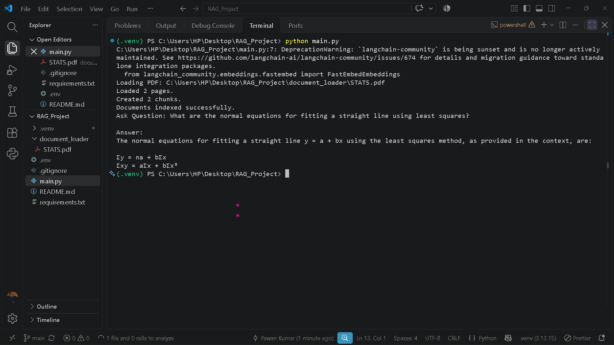

# PDF RAG Chatbot

## Overview

A Retrieval-Augmented Generation (RAG) chatbot built using LangChain, Qdrant, FastEmbed, and NVIDIA AI to answer questions from PDF documents.

## Features

- PDF document loading
- Text chunking
- Vector embeddings
- Semantic search
- Qdrant vector database
- Context-aware answer generation

## Architecture

PDF → Chunking → Embeddings → Qdrant → Retriever → NVIDIA LLM → Answer

## Technologies Used

- Python
- LangChain
- FastEmbed
- Qdrant
- NVIDIA AI Endpoints

## Demo Output



### Sample Query

```text
What are the normal equations for fitting a straight line using least squares?
```

### Sample Response

```text
Σy = na + bΣx

Σxy = aΣx + bΣx²
```

## Installation

```bash
pip install -r requirements.txt
```

## Run

```bash
python main.py
```
